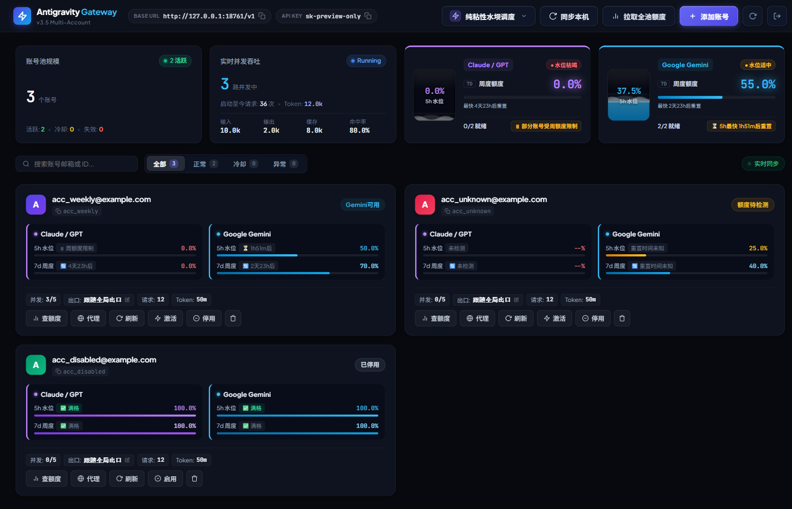
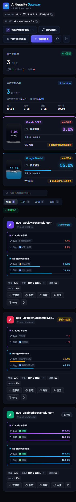

<div align="center">

# ⚡ Antigravity Proxy

**把多个 Google Antigravity 账号聚合为统一的 Claude / OpenAI 高性能代理网关**

[](https://nodejs.org/)
[](https://www.typescriptlang.org/)
[](https://fastify.dev/)
[](https://www.docker.com/)
[](LICENSE)

<p align="center">
  还在为 Claude Code 或 Cursor 搭配 Google Antigravity 时频繁遇到 429、轮询丢缓存慢成狗、甚至多账号共用 IP 被连坐封号而头疼？<br/>
  <b>Antigravity Proxy</b> 帮你把多个账号汇聚成标准 API，自动做<b>会话粘性（保 Prompt Cache）、5h 滚动双配额感知、本地排队防踩踏、长思考防断连</b>以及<b>专号专代物理隔离</b>。
</p>

<p align="center">
  <a href="#-控制台界面">控制台预览</a> •
  <a href="#-解决哪些痛点">解决哪些痛点</a> •
  <a href="#-支持的协议与模型">协议与模型</a> •
  <a href="#-快速开始">快速开始</a> •
  <a href="#-账号怎么添加">账号管理</a> •
  <a href="#-客户端接入指南">客户端配置</a> •
  <a href="#-配置项说明">配置参考</a> •
  <a href="#-常见问题-faq">FAQ</a>
</p>

<br/>



</div>

---

## 🖥️ 控制台界面

服务自带现代暗黑风格的 Web 控制台（`http://localhost:3000/admin`），密码默认为 `admin123`：

- 🌊 **双模型水仓物理监测**：实时用波浪水仓展示 **Claude 5h** 与 **Gemini 5h** 剩余额度百分比，右侧附带 7 天长期额度条与回满倒计时。
- 🔄 **调度策略一键热切换**：
  - **纯粘性水坝调度 (`zero-waste`)**：会话强粘性锁号保 Cache，新会话优先抢救即将重置的临期配额（**推荐日常使用**）。
  - **顺序耗尽模式 (`sequential-drain`)**：按顺序集中用透单个账号的 5h 额度，给前序账号留足 5 小时自然回满时间。
  - **负载均衡轮询 (`round-robin`)**：全池均匀打散，适合高并发、无上下文关联的短任务。
- 🛠️ **便捷运维动作**：一键同步本机客户端凭据、全池批量刷额度、单个账号健康探测、换绑独立代理、停用或删除账号。
- 📋 **全环境快速复制**：顶部 `BASE URL` 和 `API KEY` 点击即可复制，内置剪贴板兼容降级，即使通过 VPS 纯 HTTP、内网 IP 访问也能一键复制。

<details>
<summary>📱 点击查看移动端适配效果</summary>
<br/>
<div align="center">
  
</div>
</details>

---

## 🎯 解决哪些痛点？

很多用官方反代或者开源轮询脚本的同学，在多账号环境下经常踩这几个坑：

### 1. 为什么你的 Prompt Cache 总是命中不了？
- **传统做法**：每次请求随便找个空闲号发过去。上游 Google 看到的是不同账号，每次都得重新上传、解析几十万 Token 的上下文，响应巨慢还白白消耗配额。
- **本项目做法**：**会话强粘性锁定（Session Sticky）**。同一个对话（包括 Claude Code 派生出的子任务 Sub-agent）全部牢牢绑定在最初分配的账号上，让 Google 上游的 Prompt Cache 持续命中（通常在 **85%~90%+**），首字响应几乎秒出。

### 2. 绑定的账号并发满了怎么办？
- **传统做法**：只要号忙了就立马跳到新号，直接击穿缓存。
- **本项目做法**：**本地公平排队（默认等 120 秒）**。如果绑定的账号暂时占满了，请求会在本地队列里耐心等待槽位释放，绝不轻易弃号；同一个账号下的不同对话轮流调度（FIFO），谁也不会饿死。

### 3. Claude Code 长思考动不动就超时断连？
- **传统做法**：模型深度推理一旦超过 60 秒不出字，反代中间件或本地网络直接当成超时掐断连接。
- **本项目做法**：底层采用**原生 HTTP/2 连接**，搭配每 15 秒主动推一条 SSE 保活注释（`: keepalive\n\n`）。就算模型思考 10 到 15 分钟，客户端连接也稳如泰山。

### 4. 账号多但全挂同一个 IP 被连坐封号？
- **传统做法**：所有账号走同一个全局代理，一旦 IP 被风控，池子里的号批量暴毙。
- **本项目做法**：**专号专代（独立代理出口）**。在控制台里可以给每个账号单独配置不同的 `proxyUrl`（支持填入不同的落地节点），实现账号间的物理网络隔离；启动时如果发现多账号共用单 IP 还会主动发出提醒。

### 5. 5小时额度和短期限频（RPM）傻傻分不清？
- **传统做法**：只要撞了 429 就以为号废了，要么盲目重试搞爆全池，要么把号冷却好几天。
- **本项目做法**：精准细分上游错误。真正的 `QUOTA_EXHAUSTED` 会把该模型族标记耗尽，并把请求平滑切到有额度的备用号；普通限频则严格遵守 Google 返回的 `Retry-After` 秒数进行冷却，不乱跳号。

### 6. 上下文超限时 Claude Code 报错停滞？
- **本项目做法**：当长对话超过 1M 上下文上限时，网关精准返回官方标准短语 `prompt is too long: X tokens > Y maximum`，Claude Code 收到后会**自动触发内置的历史上下文压缩（Compaction）**，压缩完接着跑，不用你手动去清理对话。

---

## 🔌 支持的协议与模型

对外提供统一的网关接口，无缝兼容各大主流生态：

| 接口端点 | 协议标准 | 适用客户端 / 工具 |
| :--- | :--- | :--- |
| `POST /v1/messages` | **Anthropic Messages** | **Claude Code CLI 原生直连**、CC Switch、LibreChat |
| `POST /v1/chat/completions` | **OpenAI Chat Completions** | Cursor、NextChat、Cherry Studio、OneAPI / NewAPI、Cline / Roo Code |
| `POST /v1/responses` | **Codex Responses API** | 新版 OpenAI Codex、Responses 规范兼容客户端 |
| `GET /v1/models` | **模型目录查询** | 动态拉取上游真实模型，自动合并冗余后缀 |
| `GET /v1/user/balance` | **用量余额接口** | CC Switch、NewAPI、OneAPI 实时拉取配额与回血时间 |

### 🧠 动态思考强度控制 (Thinking Effort)
不用再去把模型名字硬改成 `xxx-high` 或 `xxx-low`。直接传官方标准的参数即可生效：
- Claude Code 里直接用 `/effort <level>` 命令（支持 `minimal`、`low`、`medium`、`high`、`xhigh`、`max` 六档）；
- OpenAI 协议直接传 `reasoning_effort`；
- 如果传了 `budget_tokens`，网关会自动帮你转换为 Google 底座支持的思考 Token 上限。

---

## 🚀 快速开始

### 方式 1：Docker Compose 部署（推荐，极简无痛）

在一台装好 Docker 的机器上创建 `docker-compose.yml`：

```yaml
version: '3.8'

services:
  antigravity-proxy:
    image: ghcr.io/nnnextyear/antigravity-proxy:latest
    build: .
    container_name: antigravity-proxy
    restart: unless-stopped
    ports:
      - "3000:3000"
    environment:
      - PORT=3000
      - HOST=0.0.0.0
      - API_MASTER_KEY=sk-antigravity
      - ADMIN_PASSWORD=admin123
      - ROUTING_STRATEGY=zero-waste
      - STREAM_KEEPALIVE_MS=15000
      - UPSTREAM_TIMEOUT_MS=900000
      - DEFAULT_PROXY_URL=http://127.0.0.1:7897
    volumes:
      - ./data:/app/data
      - ./config.json:/app/config.json
```

启动容器：
```bash
docker compose up -d
docker compose logs -f
```

---

### 方式 2：本地 Node.js 源码直接跑

#### 1. 准备环境
- **Node.js**：`>= v20.0.0`（推荐 Node.js 22 LTS）
- **Git**

#### 2. 克隆与安装
```bash
git clone https://github.com/nnnextyear/antigravity-proxy.git
cd antigravity-proxy

# 安装依赖
npm install

# 编译代码
npm run build
```

#### 3. 配置文件
```bash
cp config.example.json config.json
```
根据你的需要改改 `config.json`（一般保持默认就能直接用）。

#### 4. 启动服务
```bash
# 直接前台启动
npm start

# 或者用 PM2 在后台守护运行
npm install -g pm2
pm2 start "npm start" --name antigravity-proxy
pm2 save
```

启动成功后，终端会打印如下地址：
```text
[Server] Antigravity Proxy listening on http://0.0.0.0:3000
[Server] Web Dashboard: http://localhost:3000/admin
[Server] OpenAI API: http://localhost:3000/v1/chat/completions
[Server] Anthropic API: http://localhost:3000/v1/messages
[Server] Responses API: http://localhost:3000/v1/responses
```

---

## 🔑 账号怎么添加？

系统支持三种方式录入账号：

### 1. 同步本机已登录凭据（最省事）
如果你本机已经装了并登录过 Antigravity 官方客户端：
- 直接打开网页控制台 `http://localhost:3000/admin`，点击顶部 **【同步本机】**；
- 或者在终端直接执行：
  ```bash
  npm run extract-local
  ```
  脚本会自动找到本地的安全数据库，把 Refresh Token 提取并加入账号池。

### 2. 命令行 OAuth 向导授权（多账号必备）
在服务器或者没有图形界面的终端里添加账号：
```bash
npm run login
```
终端会输出一个 Google 官方的 OAuth 授权链接，复制到浏览器点允许，服务就会自动接管回调把账号存下来。想加几个号就重复跑几次。

### 3. 后台手动填写
打开网页控制台，点右上角 **+ 添加账号**，填入邮箱、Refresh Token，如果该账号有专用代理也可以直接填上 `proxyUrl`。

---

## 💻 客户端接入指南

### 1. Claude Code CLI 官方直连（体验最佳）

加两行环境变量，打开终端就能用：

**macOS / Linux:**
```bash
export ANTHROPIC_BASE_URL="http://127.0.0.1:3000"
export ANTHROPIC_API_KEY="sk-antigravity"
claude
```

**Windows (PowerShell):**
```powershell
$env:ANTHROPIC_BASE_URL="http://127.0.0.1:3000"
$env:ANTHROPIC_API_KEY="sk-antigravity"
claude
```

---

### 2. CC Switch（多平台管理工具）

- **提供商类型**：选择 `Anthropic` 或 `OpenAI`
- **API Base URL**：`http://127.0.0.1:3000/v1`
- **API Key**：`sk-antigravity`
- **模型同步**：点击“获取模型”直接拉出实时列表。

<details>
<summary>📊 想在 CC Switch 里看当前 5h 剩余额度和回血时间？展开查看配置</summary>

在 CC Switch 提供商卡片上点 **用量查询** 开关，配置提取器：
- **URL**：`http://127.0.0.1:3000/v1/user/balance`
- **Method**：`GET`
- **Headers**：`{"Authorization": "Bearer {{apiKey}}"}`
- **提取脚本**：
  ```javascript
  ({
    request: {
      url: "http://127.0.0.1:3000/v1/user/balance",
      method: "GET",
      headers: { "Authorization": "Bearer {{apiKey}}" }
    },
    extractor: function (response) {
      const data = typeof response === "string" ? JSON.parse(response) : response;
      return {
        isValid: data.isValid ?? true,
        remaining: data.remaining ?? 100, // 5小时滚动剩余百分比
        unit: "%",
        used: data.used ?? 0,
        total: 100,
        planName: data.planName ?? "Antigravity Proxy"
      };
    }
  })
  ```
配置好后，卡片上就会实时显示当前在线账号数、平均剩余额度和回满倒计时。
</details>

---

### 3. Cursor / Cline / Roo Code / Codex

- **接口类型**：选择 `OpenAI Compatible`
- **Base URL**：`http://127.0.0.1:3000/v1`
- **API Key**：`sk-antigravity`
- **Model**：填 `claude-3-7-sonnet` 或 `gemini-3.8-flash`
- *注：如果是新版 Codex，支持原生 `POST /v1/responses`，把上面的 Base URL 贴进去即可。*

---

### 4. NextChat / Cherry Studio / OneAPI

- **接口地址**：`http://127.0.0.1:3000/v1`
- **API Key**：`sk-antigravity`
- 模型管理里点击“从服务商拉取”，会自动拉出所有可用模型。

---

### 5. 代码调用示例

<details>
<summary>Python (OpenAI 官方 SDK)</summary>

```python
from openai import OpenAI

client = OpenAI(
    base_url="http://127.0.0.1:3000/v1",
    api_key="sk-antigravity"
)

response = client.chat.completions.create(
    model="gemini-3.8-flash",
    messages=[{"role": "user", "content": "9.11 和 9.8 谁大？请详细推理。"}],
    reasoning_effort="high",
    stream=True
)

for chunk in response:
    content = chunk.choices[0].delta.content or ""
    print(content, end="", flush=True)
```
</details>

<details>
<summary>Node.js / TypeScript (Anthropic 官方 SDK)</summary>

```typescript
import Anthropic from '@anthropic-ai/sdk';

const anthropic = new Anthropic({
  baseURL: 'http://127.0.0.1:3000',
  apiKey: 'sk-antigravity'
});

async function main() {
  const stream = await anthropic.messages.stream({
    model: 'claude-3-7-sonnet',
    max_tokens: 4096,
    messages: [{ role: 'user', content: '写一个带并发控制的 Promise Pool' }]
  });

  for await (const event of stream) {
    if (event.type === 'content_block_delta' && event.delta.type === 'text_delta') {
      process.stdout.write(event.delta.text);
    }
  }
}
main();
```
</details>

---

## ⚙️ 配置项说明

可以通过根目录下的 `config.json` 或环境变量来配置服务：

| 配置项 (`config.json`) | 环境变量 | 默认值 | 说明 |
| :--- | :--- | :--- | :--- |
| `port` | `PORT` | `3000` | 服务运行端口 |
| `host` | `HOST` | `0.0.0.0` | 监听地址 |
| `apiMasterKey` | `API_MASTER_KEY` | `sk-antigravity` | 客户端调用 API 时填的 Key |
| `adminPassword` | `ADMIN_PASSWORD` | `admin123` | 打开控制台网页的登录密码 |
| `defaultProxyUrl` | `DEFAULT_PROXY_URL` | `http://127.0.0.1:7897` | 全局兜底代理（支持 HTTP/HTTPS 协议） |
| `routingStrategy` | `ROUTING_STRATEGY` | `zero-waste` | 调度策略 (`zero-waste` / `sequential-drain` / `round-robin`) |
| `defaultMaxConcurrency` | - | `5` | 单个账号允许的最大同时并发数 |
| `cooldownSeconds` | - | `60` | 遇到 429 时默认的冷却秒数（如果上游有传 Retry-After 则以上游为准） |
| `tokenRefreshIntervalMs`| - | `180000` | 后台检查并自动刷新 Token 的周期（毫秒，默认 3 分钟） |
| `streamKeepaliveMs` | - | `15000` | 长思考流式响应向客户端发送保活帧的间隔（毫秒） |
| `upstreamTimeoutMs` | - | `900000` | 单次生成等待上游的首字节最长超时（默认 15 分钟） |
| `minRequestIntervalMs` | - | `1000` | 同一账号连续两次发起生成的最小间隔（毫秒），抹平瞬时并发突刺 |
| `accountQueueTimeoutMs` | `ACCOUNT_QUEUE_TIMEOUT_MS` | `120000` | 绑定的账号忙时，在本地排队的最长时间（毫秒，默认 2 分钟） |
| `maxAccountQueue` | `MAX_ACCOUNT_QUEUE` | `100` | 单个账号最多允许排队的请求个数 |
| `maxConversationQueue` | `MAX_CONVERSATION_QUEUE` | `32` | 单个对话（含其派生子智能体）最多允许排队的请求数 |
| `maxTotalQueue` | `MAX_TOTAL_QUEUE` | `1000` | 全局最大等待排队队列深度 |

---

## ❓ 常见问题 (FAQ)

<details>
<summary><strong>Q1: 为什么提示 "User location is not supported" 或 403 地区限制？</strong></summary>

Google CloudCode 对请求出口 IP 所在地区有严格限制。  
**解决方式**：在 `config.json` 中配置 `defaultProxyUrl`，或者在控制台网页里给账号单独配置代理节点。建议使用**美国(US)、日本(JP)、新加坡(SG)、台湾(TW)** 等地区节点，千万不要用香港(HK)节点或大陆直连。
</details>

<details>
<summary><strong>Q2: 多个账号会不会在请求中途乱跳，导致我正在聊的对话丢了缓存？</strong></summary>

不会。系统有强会话粘性保障，同一个会话的指纹（包括 Claude Code 发起任务生成的子智能体 Sub-agent）全部自动继承绑定在同一账号上。除非该账号彻底失效或者配额完全耗尽，否则绝不会无故切号。
</details>

<details>
<summary><strong>Q3: 遇到 429 限频怎么办？账号会挂掉吗？</strong></summary>

不会挂。系统能精准识别真正的 5 小时额度耗尽与短时间的频率超限（RPM）：
- 如果是短时超频，账号进入自动冷却，严格遵守上游返回的秒数，倒计时结束后自动复活；
- 如果只是 Claude 额度用完了，系统只会标记该账号的 Claude 额度耗尽，正在跑的 Gemini 请求不受任何影响。
</details>

<details>
<summary><strong>Q4: 复制 API Key 为什么有的人点不动？</strong></summary>

很多浏览器出于安全策略，只允许在 HTTPS 或 `localhost` 环境调用原生剪贴板 API。如果你是用云服务器公网 IP 或局域网内网 IP（HTTP）访问，原生 API 会被禁用。  
本项目前端已内置**三层降级方案**，即使在非安全 HTTP、手机端内嵌浏览器下也能自动降级通过虚拟文本框完成复制，完全不用担心点不动。
</details>

<details>
<summary><strong>Q5: 多账号如何彻底防止被 Google 关联？</strong></summary>

Google 关联风控主要看两点：**相同的出口 IP** 与 **相同的 TLS 连接特征**。  
强烈建议在控制台的账号卡片上，点击 **【代理】**，给每一个账号分别填入不同的代理出口（例如专号专用的节点地址），这样每个账号都拥有完全独立的网络链路与 TCP 隧道，物理级防连坐。
</details>

---

<div align="center">

如果这个项目对你的日常开发或团队提效有所帮助，欢迎在 GitHub 上点亮一颗 ⭐ **Star** 支持一下！

[GitHub 仓库地址](https://github.com/nnnextyear/antigravity-proxy)

</div>
